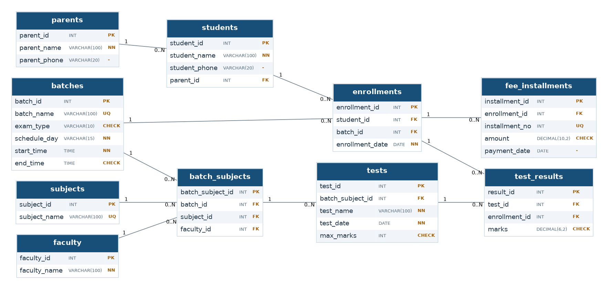

# Normalised Database Design for a Coaching Centre

**AVIRENZA Internship — Database Management (SQL), Task 1**  
**Database engine:** MySQL v9 (tested using DB Fiddle)  
**Domain:** A fictional JEE/NEET coaching centre in Kota.

## Overview

This project transforms a single error-prone spreadsheet into a relational database. It models students, their parents or guardians, batches and schedules, subjects, faculty assignments, enrolments, fee instalments, tests, and test results. The design uses **10 tables**, junction tables for many-to-many relationships, and 3NF as the target normal form.

## Files

| Path | Description |
| --- | --- |
| `docs/business-rules.md` | Business rules and modelling assumptions |
| `docs/normalisation.md` | Worked UNF → 1NF → 2NF → 3NF example and anomalies |
| `docs/er-diagram.png` | ER diagram, including PK, FK and 1-to-many cardinalities |
| `docs/er-diagram.dot` | Editable Graphviz source for the diagram |
| `docs/data-dictionary.md` | Every table, field, data type and constraint |
| `sql/01-schema.sql` | Complete MySQL DDL: tables and two result-validation triggers |
| `sql/02-sample-data.sql` | Fictional data: 192 rows across 10 tables, 40 results |
| `sql/03-constraint-checks.sql` | Five intentionally failing verification tests (commented) |
| `screenshots/schema-loaded.png` | DB Fiddle constraint inventory screenshot |
| `screenshots/constraint-errors.png` | First three constraint failures captured in DB Fiddle |
| `screenshots/trigger-errors.png` | Two additional trigger failures captured in DB Fiddle |

## Entity relationship diagram

The two many-to-many relationships (student–batch and batch–subject) use junction tables `enrollments` and `batch_subjects`. All 10 foreign keys have `ON DELETE RESTRICT`.

## Run the project (DB Fiddle)

1. Open [DB Fiddle](https://www.db-fiddle.com/) and choose **MySQL v9**, or a modern MySQL version supporting enforced `CHECK` constraints (8.0.16+).
2. Paste the entire `sql/01-schema.sql` script into the **Schema SQL** editor. The two triggers use single-statement `SET` syntax for compatibility with the online editor; no `DELIMITER` directives are needed.
3. Paste `sql/02-sample-data.sql` into **Query SQL** and select **Run**. Do not also run any old inserts in the same session; this file already includes all sample records.
4. Confirm the counts: parents 10; students 12; batches 10; subjects 10; faculty 10; enrollments 20; batch_subjects 20; fee_installments 40; tests 20; test_results 40. There should be **192 total records**, including **40 test results**.
5. To perform the constraint checks, see `sql/03-constraint-checks.sql`. Run **one** intentionally invalid statement at a time in Query SQL after loading valid sample data, and capture its error. Remove it before the next check.
6. To inspect the schema, run `SHOW TABLES;` or query `information_schema.table_constraints`. DB Fiddle rebuilds the schema for each run.

## Validation

- The schema defines 10 primary keys, 10 foreign keys, 6 `UNIQUE` constraints and 6 `CHECK` constraints.
- Test cases demonstrate rejection of an invalid exam type, a duplicate subject and an unknown parent foreign key.
- `BEFORE INSERT` and `BEFORE UPDATE` triggers on `test_results` reject marks greater than the test maximum and an enrollment from the wrong test batch. Tests were captured on MySQL v9 in DB Fiddle.

**Implementation limitation:** The result triggers protect direct writes to `test_results` only. Subsequent changes to `tests.max_marks`, `enrollments.batch_id`, or `batch_subjects.batch_id` could invalidate existing results; a production deployment should add parent-table validation or redesign the relevant keys. The simple time fields model one daily time slot per batch, not a comprehensive recurring calendar.

## Tools

- MySQL (DB Fiddle online environment)
- dbdiagram.io (initial ER model)
- Graphviz (exported final ER diagram)
- Markdown (documentation)

## What I learned

I practised converting business requirements into entities and relationships, resolving many-to-many relationships with junction tables, describing the 1NF → 3NF normalisation process, implementing MySQL keys and constraints, seeding tables in foreign-key order, and testing database integrity with both expected successes and intentional constraint failures.

All names, phone tokens, and scores in this project are fictional. No passwords, API keys or personal identification documents are included.
